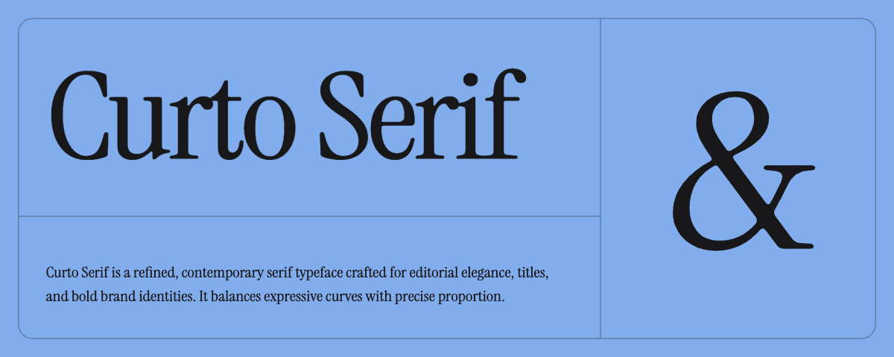
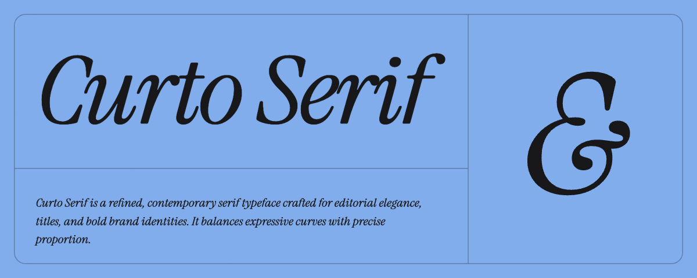

# Curto Serif
A refined, contemporary serif typeface for editorial elegance, titles, and bold brand identities — by [Dev Chauhan](https://devchauhan.in).





## Preview

[**devchauhan.in/curto**](https://devchauhan.in/curto) — live specimen.

## Download

[**⬇ CurtoSerif-1.000.zip**](CurtoSerif-1.000.zip) — OTF, TTF, and WOFF2 files with the `curto.css` stylesheet and the OFL license.

## Install

**Desktop** — install the `.otf` (or `.ttf`) files from the zip.
- macOS: double-click and choose *Install Font*.
- Windows: right-click → *Install*.

**Web** — link the stylesheet:

```html
<link rel="stylesheet" href="src/curto.css">
<h1 style='font-family:"Curto Serif"'>Curto Serif</h1>
<p style='font-family:"Curto Serif";font-style:italic'>Italic works too.</p>
```

**Weight** — 400 (Regular), in Regular and Italic. No bold, no variable axis.

## License

Licensed under the [SIL Open Font License 1.1](OFL.txt) — free to use, modify, and redistribute.

Repository: https://github.com/dqev/curto.git
