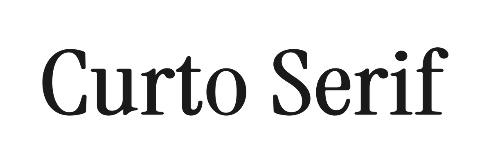

<p align="center">
<picture>
  <source media="(prefers-color-scheme: dark)" srcset="documentation/curto-serif-hero-light.png">
  <source media="(prefers-color-scheme: light)" srcset="documentation/curto-serif-hero-dark.png">
  
</picture>
</p>

<p align="center">A refined, contemporary serif typeface for editorial elegance, titles, and bold brand identities.</p>

<p align="center">
  <a href="https://devchauhan.in/curto"><picture><source media="(prefers-color-scheme: dark)" srcset="documentation/pill-live-light.svg"></picture></a>
  <a href="#download"><picture><source media="(prefers-color-scheme: dark)" srcset="documentation/pill-download-light.svg"></picture></a>
  <a href="https://github.com/dqev/curto/releases"><picture><source media="(prefers-color-scheme: dark)" srcset="documentation/pill-release-light.svg"></picture></a>
  <a href="https://devchauhan.in/curto"><picture><source media="(prefers-color-scheme: dark)" srcset="documentation/pill-beta-light.svg"></picture></a>
</p>

Curto Serif is a contemporary text and display serif with a high-contrast,
editorial voice. The family spans Regular (400) through Bold (700) in Roman and
Italic, with static and variable (`wght`) builds. It covers the Google Fonts
Latin Core glyphset, including the Latin Extended, punctuation, symbols, and
currency characters needed for broad Latin-script typography.

## Download

- [**CurtoSerif-1.001-beta.zip**](releases/CurtoSerif-1.001-beta.zip) — current family. Weights 400–700, Roman and Italic, static + variable.
- [**CurtoSerif-1.000.zip**](releases/CurtoSerif-1.000.zip) — first release. Weight 400, Roman and Italic.

All releases are also on the [Releases page](https://github.com/dqev/curto/releases).

## Weights and formats

| Weight | Roman | Italic | Formats |
| --- | --- | --- | --- |
| 400 Regular | `CurtoSerif-Regular` | `CurtoSerif-Italic` | TTF, OTF, WOFF2 |
| 500 Medium | `CurtoSerif-Medium` | `CurtoSerif-MediumItalic` | TTF, OTF, WOFF2 |
| 600 SemiBold | `CurtoSerif-SemiBold` | `CurtoSerif-SemiBoldItalic` | TTF, OTF, WOFF2 |
| 700 Bold | `CurtoSerif-Bold` | `CurtoSerif-BoldItalic` | TTF, OTF, WOFF2 |
| 400–700 variable | `CurtoSerif[wght]` | `CurtoSerif-Italic[wght]` | TTF, WOFF2 |

Binaries live in `fonts/ttf`, `fonts/otf`, `fonts/variable`, and
`fonts/webfonts`.

## Install

**Desktop** — install the `.otf` or `.ttf` files from `fonts/otf` or `fonts/ttf`.
- macOS: double-click → *Install Font*.
- Windows: right-click → *Install*.

**Web** — link the stylesheet from the repository root:

```html
<link rel="stylesheet" href="curto.css">
<h1 style='font-family:"Curto Serif";font-weight:700'>Curto Serif</h1>
<p style='font-family:"Curto Serif";font-style:italic'>Italic works too.</p>
```

## Building

Fonts are built automatically by GitHub Actions — check the **Actions** tab for
the latest build. To build locally:

```sh
make build   # build fonts into fonts/
make test    # run Fontspector QA checks
make proof   # generate HTML proofs in out/proof/
```

`make build` creates an isolated `venv`, installs the pinned requirements, and
runs the reproducible pipeline in `sources/scripts/build_family.py`. That script
writes static TTF/OTF and variable TTF builds into `fonts/`, generates WOFF2
webfonts, and applies the family naming, OS/2, and licensing metadata. The same
sources can also be built with `gftools builder sources/config.yaml`.

## About

Curto Serif is designed and maintained by Dev Chauhan. The project is fully
open source under the SIL Open Font License, with sources, build scripts, and
release archives available in this repository.

## Changelog

See [release notes for version 1.001](documentation/release-notes-1.001.md) and
the [GitHub Releases page](https://github.com/dqev/curto/releases).

## Project structure

```
.
├── AUTHORS.txt
├── CONTRIBUTORS.txt
├── OFL.txt
├── README.md
├── Makefile
├── curto.css
├── demo/                 # browser specimen
├── documentation/        # article, images, social assets, release notes
├── fonts/
│   ├── otf/
│   ├── ttf/
│   ├── variable/
│   └── webfonts/
├── releases/             # downloadable archives
├── requirements.in
├── requirements.txt
├── scripts/
└── sources/
    ├── Curto.glyphs
    ├── Curto_Italic.glyphs
    ├── config.yaml
    └── scripts/          # reproducible build pipeline
```

## License

[SIL Open Font License 1.1](OFL.txt) — free to use, modify, and redistribute.
The font sources and binaries are licensed under the OFL. Images in
`documentation/` are licensed under [CC BY-SA 4.0](documentation/images-license.txt).

## Authors

- Dev Chauhan — design and development. See [AUTHORS.txt](AUTHORS.txt) and
  [CONTRIBUTORS.txt](CONTRIBUTORS.txt).
